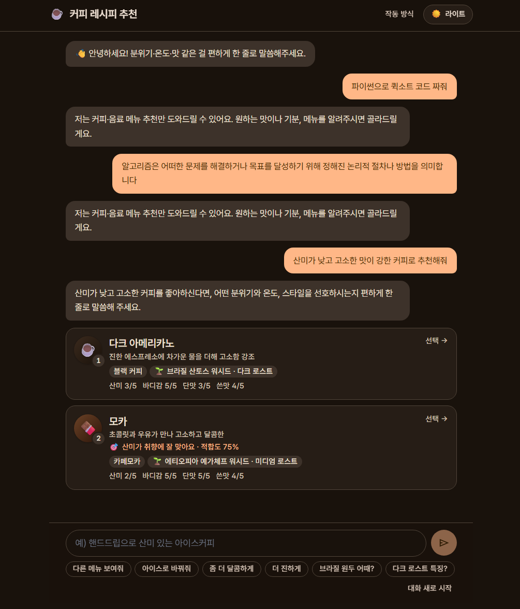
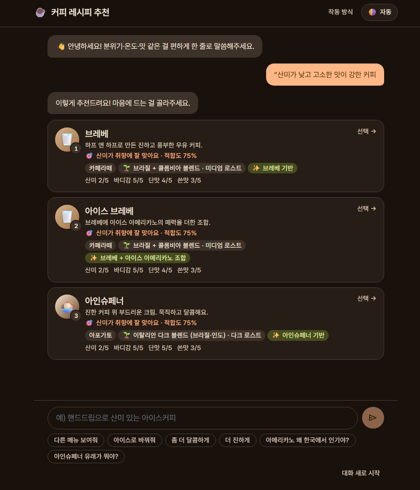
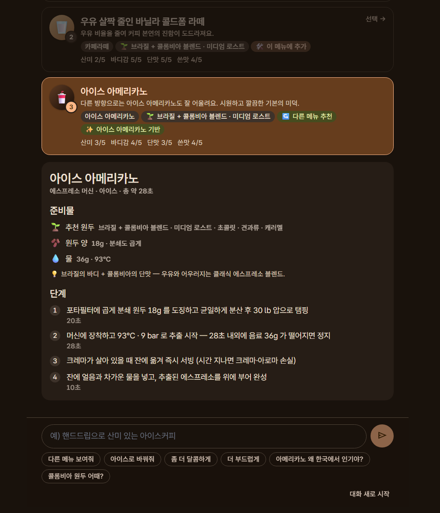
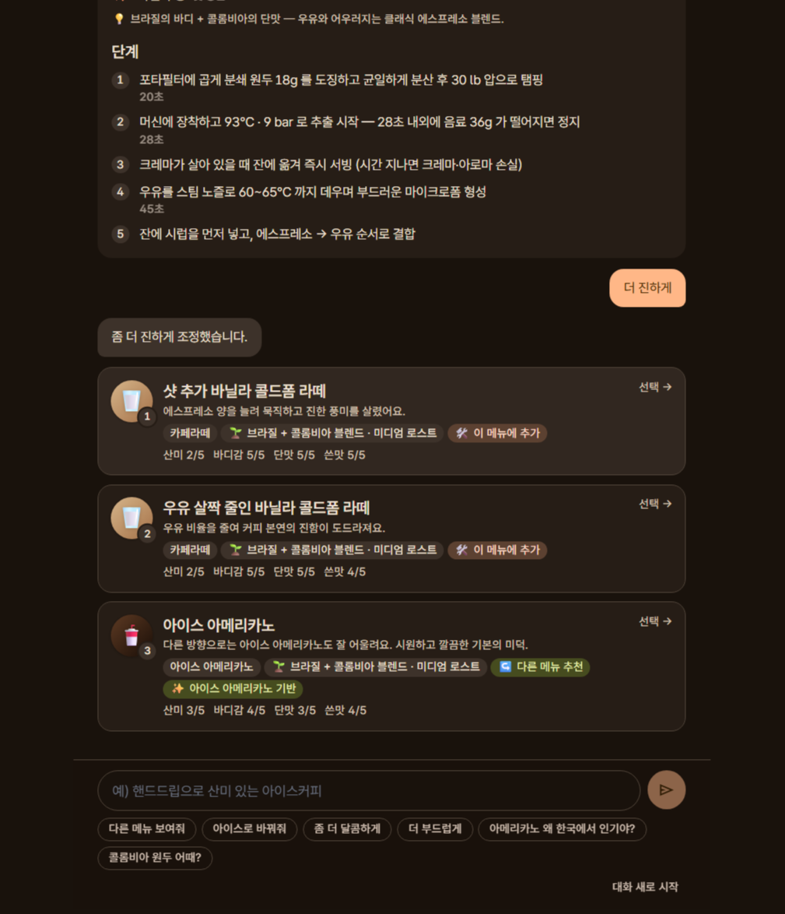
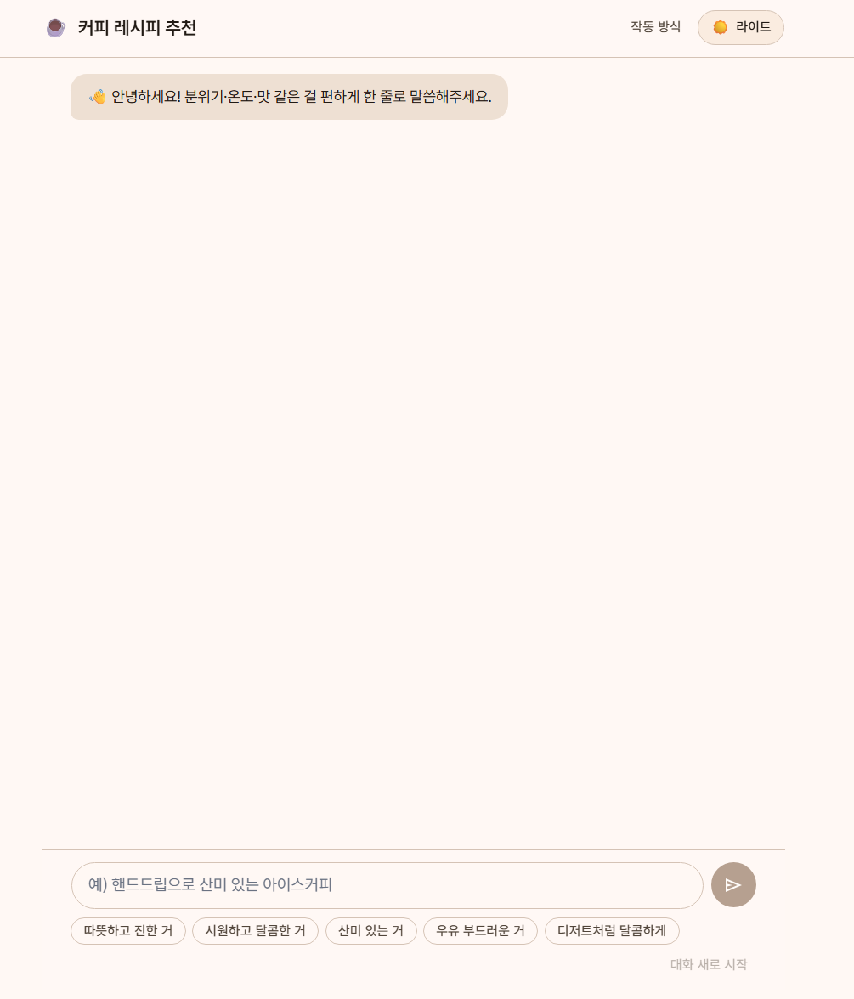

# Morgorithm

> 자연어 한 줄로 취향을 말하면 LLM 이 **함수 호출(tool use)로 후보 메뉴를 실시간 생성**하고, **직접 구현한 알고리즘**(표준 정렬·맵 미사용)이 점수화·정렬·다양성·블렌딩으로 최종 3장을 고르는 SvelteKit 웹앱.

**🔗 배포 / Live demo: <https://morgorithm.dotoroi.xyz/>** · 2026 Algorithm Team Project

> [!WARNING]
> **보안 주의 — `morgorithm.dotoroi.xyz`**
> 이 도메인은 [`server3342`](https://github.com/server3342) 가 **임시로** 유지·관리하는 것으로, **사전 통보 없이 사라지거나 악의적인 제3자에게 소유권이 넘어갈 수 있다.** 따라서 **개인정보 등 민감한 정보는 절대 입력하지 말 것.**
>
> **Security notice — `morgorithm.dotoroi.xyz`**
> This domain is maintained **temporarily** by [`server3342`](https://github.com/server3342). **It may disappear without notice or be transferred to a malicious third party at any time.** **Do not enter sensitive information such as personal data.**

`plan.md`, `fix.md`, `info.md`, `upstage.md` — 모두 로컬 작업 노트로 repo 에는 포함되지 않는다.

**📄 산출물 문서:** [기술 보고서](TECHNICAL_REPORT.md) · [개발 과정](DEVELOPMENT_PROCESS.md) · [기여 분석](CONTRIBUTIONS.md) · [발표 슬라이드(PDF)](docs/Morgorithm_PresentationSlides.pdf)

---

## 개요

알고리즘 수업 프로젝트의 본 취지를 살려, **데이터는 LLM 이 실시간 생성하되 점수화·정렬·선택은 직접 구현한 알고리즘**이 맡는다 (하드코딩 메뉴 카탈로그에 의존하지 않음).

- **LLM (Upstage Solar)** — 자연어 이해 + **함수 호출로 후보 메뉴/원두 실시간 생성** + 도메인 Q&A. 정적 레시피 목록을 주입하지 않고 매 요청 자체 지식으로 떠올린다.
- **직접 구현 알고리즘** — 점수화 · 정렬 · 다양성 · 그리디 · 블렌딩. LLM 이 만든 후보 위에서 결정적으로 최종 선택.
- **커피 도메인 Q&A** — "에티오피아 원두 어때?", "콜드브루 어떻게 만들어?" 같은 지식 질문은 종결 도구 `present_answer` 로 분기(`intent="ask"`). 키 없을 때는 `info.md` 다이제스트 기반 결정적 답변으로 폴백.
- **시연** — 추천 레시피로 강의실에서 실제 추출. 사업화 컨셉은 "원두 구매 시 커미션 수익".

초기에는 단계형 폼 UI + Python FastAPI 백엔드로 출발했으나, 채팅 중심 UX 로 전환하면서 알고리즘을 TypeScript 로 포팅하고 Cloudflare Workers 단일 스택으로 통합했다. 이후 single-shot 프롬프트(라이브러리 주입) 방식에서 **함수 호출 루프(LLM 생성 → 알고리즘 랭킹)** 로 재설계했다(상세 `plan.md` §50). Python 원형은 [`skeleton/`](skeleton/) 에 보존 — 시연·리포트 목적.

---

## 데모

> 라이브 데모: <https://morgorithm.dotoroi.xyz/> · 작동 방식 시각화: [`/about`](https://morgorithm.dotoroi.xyz/about)

### off-topic 거절 + 추천 한눈에



- **off-topic 거절** — "파이썬으로 퀵소트 코드 짜줘" 같은 커피와 무관한 입력은 아무 레시피도 만들지 않고 *"저는 커피·음료 메뉴 추천만 도와드릴 수 있어요"* 로 정중히 거절한다.
- **🎯 추천 근거** — *"산미가 취향에 잘 맞아요 · 적합도 75%"* 처럼, LLM 마케팅 문구가 아니라 **직접 구현한 점수 알고리즘**이 산출한 근거를 사용자가 말한 맛 축 기준으로 한 줄 보여준다.

### 추천 결과 — 다양화 + 하이브리드 + 적합도



LLM 이 생성한 후보를 **점수화 → mergeSort → diversify** 로 추려 서로 다른 카테고리 3장으로 보여준다. 각 카드에 예상 맛 4축(산미·바디감·단맛·쓴맛), 🌱 추천 원두(산지·로스트), 그리고 *"○○ 기반 / ○○ + ○○ 조합"* 같은 라이브러리 조합 배지를 표시한다.

### 레시피 상세 — 카드 클릭 시 펼침



카드를 누르면 추출 기구별 단계(분쇄·물온도·시간 등)와 원두 힌트가 인라인으로 펼쳐진다.

### 후속 다듬기 (refine)



"더 진하게", "우유 줄여줘" 같은 후속 한 줄에 대해 고른 메뉴를 살짝 바꾼 **변형(🛠️ 이 메뉴에 추가)** 과 **대안(↪️ 다른 메뉴 추천)** 을 같은 알고리즘 파이프라인으로 만든다.

### 라이트 / 다크 테마

| 다크 | 라이트 |
|------|--------|
|  |  |

---

## 채팅 흐름

```
사용자 한 줄 (예: "달콤하고 부드러운 따뜻한 거")
   ▼
POST /api/chat/propose  (함수 호출 루프)
   게이트: 커피·음료 요청인가? (도메인 키워드 1차 → 신호 없으면 LLM temp 0 분류)
          무관(off-topic)하면 정중히 거절하고 레시피를 만들지 않는다
   LLM: 종결 도구 present_recommendations 로 후보 5~6개 실시간 생성
        (각 후보 = enum 특징 + 예상 5축 + 원두 산지/로스트)
   서버: 화이트리스트 검증 → score(5축 유사도) → mergeSort → diversify → 상위 3장
        → 콜드브루 게이트(명시 요청 아니면 제외) → 카테고리 결합 → Recipe 완성
   ▼
3장 카드 (카테고리 비주얼 + 🌱 추천 원두 산지·로스트 + 예상 맛 4축: 산미·바디감·단맛·쓴맛)
클릭 시 인라인 레시피 펼침
   ▼ 후속 한 줄
POST /api/chat/refine  (함수 호출 루프 — present_patch)
   "더 진하게"     → mod 1~2장 + 다른 카테고리 alt 1장
   "오트 우유로"   → milk_type=oat, base steps 보존
   "다른 거 또"    → 보여준 항목 회피, 신선한 후보 우선
   "라떼만 보여줘" → category_only 명시적 좁힘
   ▼ 또는 지식 질문 (어디서든)
   intent=ask → present_answer 종결 도구
   "에티오피아 원두 어때?" · "라이트 vs 다크 차이?" · "달고나 누가 만들었어?"
   → 지식 텍스트 응답(추천 상태 무변경)
```

키 없음/루프 실패/타임아웃 시 **single-shot(JSON) → 규칙 폴백**으로 단계적 강하한다. 폴백 경로는 `recipe-library.ts`(30+) 와 `coffee-knowledge.ts` 다이제스트를 그대로 활용한다.

각 추천 카드 뒤로는 *이야깃거리 후속 질문 칩*(예: "아인슈페너 유래는?", "How about Ethiopian beans?")이 함께 노출돼 *추천 → 이야기 → 다음 추천* 흐름을 유도한다. 세션은 `localStorage` 에 24h TTL 로 보관 — 새로고침해도 마지막 대화로 복귀.

---

## 직접 구현 알고리즘

`Array.prototype.sort` / `Map` / `Set`(정렬 비교) 비의존, 모두 from-scratch.

LLM 은 후보(데이터)를 생성할 뿐, 아래 알고리즘이 **점수화·정렬·다양성·블렌딩으로 최종 선택**한다 — "LLM 은 생성, 알고리즘이 일한다".

| 알고리즘 | 위치 | 역할 |
|----------|------|------|
| Merge Sort (안정 정렬) | [`sorting.ts`](website/src/lib/algorithms/sorting.ts) | 적합도 내림차순(동률은 생성 순서 보존) · 원두 가격 오름차순 — 메뉴/원두 양쪽에서 사용 |
| 5축 유사도 점수 | [`score.ts`](website/src/lib/algorithms/score.ts) | 절대 차이를 max 4 로 정규화한 평균(0~1). `profileMatchScore` 로 LLM 후보의 예상 5축을 목표 취향과 비교 |
| Diversify (그리디 재배치) | [`diversify.ts`](website/src/lib/algorithms/diversify.ts) | 정렬 결과에서 동일 카테고리 연속 회피 |
| Blend (5축 선형 보간) | [`blend.ts`](website/src/lib/algorithms/blend.ts) | 두 후보 취향/풍미를 비율로 보간 — "둘을 섞은 느낌"을 결정적으로 계산. LLM 도구 `blend_candidates` 가 호출 |
| Greedy (원두) | [`greedy.ts`](website/src/lib/algorithms/greedy.ts) | 적합도 임계치 이상 원두 가격 오름차순 top-k (`/api/beans`) |
| Greedy (메뉴 하이브리드) | [`combineEntries`](website/src/routes/api/chat/propose/+server.ts) | 두 라이브러리 항목 특징을 합쳐 하이브리드 spec — **규칙 폴백 경로**에서 사용 |

위 알고리즘들은 LLM 이 부르는 *도구*([`tools.ts`](website/src/lib/server/tools.ts))로도 노출되거나, 함수 호출 루프([`chatWithTools`](website/src/lib/server/upstage.ts))가 회수한 후보 위에서 서버가 직접 실행한다.

`sorting.ts` 에는 Lomuto 파티션 Quick Sort 도 from-scratch 로 함께 구현되어 있다 — 수업 자료/대안 비교용 보존이며 현재 호출처는 없다.

Python 원형(`merge_sort`, `quick_sort`, open-addressing `HashTable`, CLRS `RedBlackTree`)은 [`skeleton/app/algorithms/`](skeleton/app/algorithms/) 에 보존.

도메인 모델 — `TasteProfile`(5축, 1~5 이산), `MenuCategory`(11종), `BrewMethod`(5종), `RecipeEntry` 라이브러리(30+) — 는 [`website/src/lib/types/`](website/src/lib/types/) · [`recipe-library.ts`](website/src/lib/data/recipe-library.ts).

---

## API

| 경로 | 입력 → 출력 |
|------|------------|
| `POST` [`/api/chat/propose`](website/src/routes/api/chat/propose/+server.ts) | 메시지 + 컨텍스트 → (함수 호출) 후보 풀 생성 → 알고리즘 랭킹 3장 / `present_answer` 면 지식 답변 |
| `POST` [`/api/chat/refine`](website/src/routes/api/chat/refine/+server.ts) | 후속 한 줄 → (함수 호출 `present_patch`) 패치(constraints / profile_delta) + mod/alt, 또는 ask 텍스트 |
| `POST` [`/api/beans`](website/src/routes/api/beans/+server.ts) | 취향 → 그리디 top-k 원두 |
| `POST` [`/api/preference`](website/src/routes/api/preference/+server.ts) | 자유 텍스트 → 5축 |
| `POST` [`/api/recipe`](website/src/routes/api/recipe/+server.ts) | 5축 + 기구 → 정렬된 레시피 N개 |
| `POST` [`/api/beginner`](website/src/routes/api/beginner/+server.ts) | 자연어 → 5축 + 카테고리 풀 + 후보 8개 |

모든 LLM 출력(생성 후보의 enum·예상 5축·원두 힌트, refine 패치)은 화이트리스트 + 1~5 clamp + delta ±2 clamp 검증을 거친다. 다이제스트 밖 사실은 만들지 못하도록 시스템 프롬프트에서 가드한다(Upstage 에 chat groundedness API 가 없어 프롬프트 가드 + 폴백 결정적 답변으로 보강).

`/api/chat/*` 1차 경로는 **함수 호출 루프**([`chatWithTools`](website/src/lib/server/upstage.ts))다. 실패/키없음/타임아웃 시 **single-shot(JSON) → 규칙 기반 폴백**(키워드 매칭 + `scoreLibrary` + 정규식 패치)으로 단계적 강하 — 어느 경로로 생성됐든 점수화·정렬·다양성은 동일하게 적용된다. 보조 엔드포인트(beans/preference/recipe/beginner)는 단발 JSON 모드를 그대로 쓴다.

> Upstage 함수 호출은 OpenAI 호환. agentic 루프엔 pro3 가 한 번에 정확하고 안정적이라 **기본값을 `solar-pro3`** 으로 둔다(`UPSTAGE_MODEL` 로 오버라이드). pro2 도 동작은 함.

---

## 실행

```bash
cd website
npm install
npm run dev                                # 로컬 (포트 5173)

# Upstage 키는 선택 — 없어도 규칙 폴백으로 전체 동작
echo 'UPSTAGE_API_KEY="..."' > .dev.vars
```

배포는 Cloudflare Workers (`npm run deploy`). 상세 명령은 아래 *개발자 가이드* 참고.

---

<details>
<summary><strong>개발자 가이드 — 기술 스택 · 디렉터리 · 검증 · 배포</strong></summary>

### 기술 스택

| 영역 | 선택 |
|------|------|
| 프레임워크 | SvelteKit 2 + Svelte 5 (runes) |
| 언어 | TypeScript (strict) |
| 스타일 | Tailwind CSS v4 (`@theme` 토큰 매핑) |
| 호스팅 | Cloudflare Workers (`adapter-cloudflare`) |
| LLM | Upstage Solar `solar-pro3` 기본 (OpenAI 호환 — 함수 호출 tool use + JSON 모드, `UPSTAGE_MODEL` 로 오버라이드) |

번들 축소를 위해 Zod 등 외부 검증 라이브러리는 쓰지 않고 [`validate.ts`](website/src/lib/server/validate.ts) 의 타입 가드 헬퍼로 대체한다.

### 디렉터리 구조

```
2026-Algorithm-Team-Project/
├── README.md                          # plan.md · fix.md · info.md · upstage.md 는 로컬 노트 (git 제외)
│
├── website/                          # 운영 스택 — SvelteKit + Cloudflare
│   ├── wrangler.jsonc
│   ├── scripts/verify-upstage.mjs    # Upstage 호출 단위 검증
│   └── src/
│       ├── routes/
│       │   ├── +page.svelte          # 채팅 페이지
│       │   ├── about/+page.svelte     # 작동 방식 (인터랙티브 플로우차트 + 시연 재생)
│       │   └── api/chat/{propose,refine} · api/{beans,preference,recipe,beginner}
│       └── lib/
│           ├── algorithms/   sorting · greedy · diversify · score · blend
│           ├── data/         recipe-library · beans_mock · coffee-knowledge · story-hooks · bean-hints
│           ├── server/       upstage(chatJson · chatWithTools) · tools · validate · recipe-generator · preference-rules · security · ratelimit
│           ├── types/        taste · brew · recipe · bean · menu · constraints · proposal
│           ├── components/   Composer · ChatBubble · ProposalCards · RecipeDetail · ui/(Card·Stars·ThemeToggle)
│           ├── util/         intent · locale · recipe-detail · uuid
│           └── stores/       client-id · theme · chat-session (localStorage)
│
└── skeleton/                         # 알고리즘 원형 (Python) — 운영 미사용
    └── app/{algorithms,schemas,services,api/routes,data}/
```

### 검증

```bash
cd website
npm run check                              # svelte-check (Node 20+ 필요)
npm run lint
node scripts/verify-upstage.mjs            # Upstage 호출 케이스 검증
```

> Node 18 이 PATH 우선인 환경에서는 `svelte-check` 가 undici `File is not defined` 로 죽는다. `PATH=/usr/local/bin:$PATH npm run check` 같이 Node 20+ 를 강제하라.

### 배포 (Cloudflare Workers)

```bash
cd website
npx wrangler secret put UPSTAGE_API_KEY    # 1회 (운영)
npm run deploy                             # 빌드 + wrangler deploy
```

### Python 원형 실행 (선택)

```bash
cd skeleton
python3 -m venv .venv && source .venv/bin/activate
pip install -r requirements.txt
pytest
```

</details>
